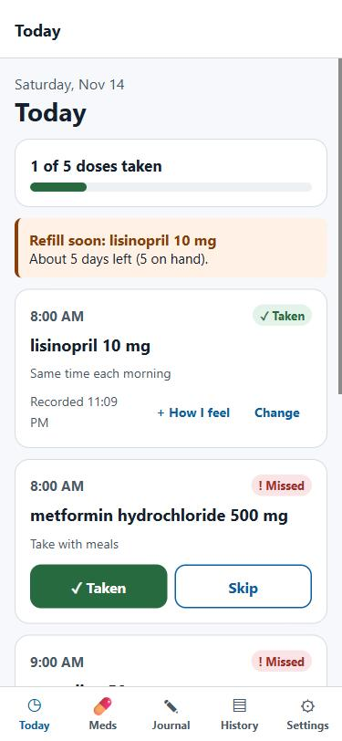
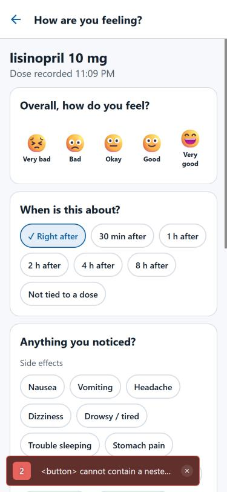
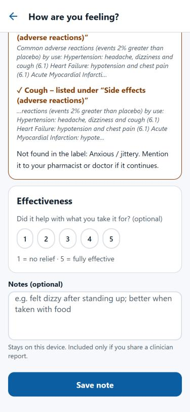
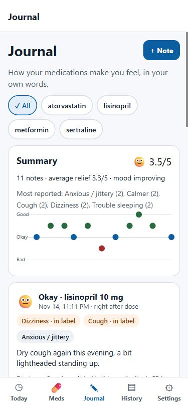

# PillPal – Medication Reminder, Effects Journal and Trusted Drug Information

COMP 4310 Web Health Informatics, Lakehead University. P4 working prototype.

PillPal is a cross-platform mobile app (React Native / Expo) that helps patients and family caregivers:

1. **add medications** from the U.S. National Library of Medicine's **RxNorm** vocabulary (standardized names + RxCUI), with manual entry as an offline fallback,
2. **get reminders** that fire on the phone even when the app is closed or offline,
3. **record each dose** as Taken / Skipped / Missed (missed is applied automatically after a grace period),
4. **note how a medication makes them feel** after taking it (mood, side effects, relief, free text). These notes are automatically **checked against the medication's official FDA label**,
5. **review history and adherence** (7 / 30 / 90 days, per medication, daily chart),
6. **read trusted drug information**: the official openFDA label, organized into clearly titled sections with the boxed warning first, and saved for offline use, and
7. **share a summary with a clinician** (medications + adherence + journal) only when they choose.

> PillPal is an organizational and informational tool. It does not diagnose, recommend treatment, or replace a doctor or pharmacist. All demo data is synthetic.

   

---

## What makes it more than a reminder app

| | Generic reminder app | PillPal |
|---|---|---|
| Medication entry | free text | RxNorm search (handles misspellings, e.g. "lipitr" → Lipitor), stores RxCUI |
| After a dose | nothing | "How are you feeling?" journal (mood, 22 effect tags, severity, relief, timing, free text) |
| Side effects | user has to look them up | each reported effect is matched **on-device** against the FDA label's adverse-reactions and warnings sections, with the source excerpt shown |
| Drug info | none | the official FDA label, organized into readable sections, cached offline, linked to DailyMed |
| Privacy | varies | personal data never leaves the phone. Only drug names or public IDs go to RxNorm and openFDA |
| Sharing | none | a clinician summary for medication reconciliation, shared through the OS share sheet |

---

## Repository layout

```
PillPal-Prototype/
├── app/                      React Native (Expo SDK 58, TypeScript, Expo Router)
│   ├── src/app/              screens (file-based routes)
│   │   ├── (tabs)/           Today · Meds · Journal · History · Settings
│   │   ├── med/              add, edit, detail
│   │   ├── note.tsx          "How are you feeling?" effects journal entry
│   │   ├── label.tsx         official FDA label (medication information)
│   │   └── report.tsx        clinician summary
│   ├── src/core/             pure, unit-tested logic: schedules, grace period, adherence,
│   │                         refills, effects ↔ label matching, RxNorm/openFDA parsing, report
│   ├── src/data/             SQLite schema/migrations, repository, SQLCipher key setup, seed data
│   ├── src/services/         notifications (reminder engine), drug info lookups, dose use-cases
│   └── __tests__/            Jest tests (core logic + the real SQL via node:sqlite) + API fixtures
├── scripts/contrast-check.mjs  WCAG 2.1 AA colour-contrast check
└── docs/                     screenshots, test evidence, demo script, P4 report
```

There is no backend server: everything runs on the phone, which talks directly to the public RxNorm and openFDA APIs.

---

## Requirements

* **Node.js 20+** (tested on Node 26). Node 22.5+ is needed to run the data-layer tests, which use `node:sqlite`.
* For the phone: the **Expo Go** app (Android / iOS), or an Android emulator / iOS simulator.

## Setup and run

```bash
git clone <this repository>
cd PillPal-Prototype/app
npm install
npx expo start
```

* Scan the QR code with **Expo Go** on your phone (same Wi‑Fi network as the computer, or use `npx expo start --tunnel`).
* **Settings → Load synthetic demo data** adds a demo person with 4 real medications (real RxCUIs), 30 days of dose history and journal notes.
* `npx expo start --web` runs a browser preview. Reminders and encryption need a phone; everything else works on web. Use the web preview in **one tab only**: the browser database can only be opened by one tab at a time, so a second tab (or sometimes a hard reload) shows a blank page until the first tab is closed.

### Encrypted database (SQLCipher)

`app.json` enables SQLCipher (`expo-sqlite` → `useSQLCipher: true`). The key is a random 256-bit value stored in the iOS Keychain / Android Keystore (`expo-secure-store`). **Expo Go does not ship SQLCipher**, so in Expo Go the app runs unencrypted and says so in *Settings → Privacy & security*. To get encryption, build a development build:

```bash
cd app
npx expo run:android      # or: npx eas-cli@latest build --profile development
```

## Tests

```bash
cd app && npm test                  # 51 Jest tests: scheduling, grace period, adherence, refills,
                                    # effects↔label matching, RxNorm/openFDA parsing, SQL repository,
                                    # E3 performance on ~3,800 dose records
cd app && npm run typecheck && npx eslint .
node scripts/contrast-check.mjs     # WCAG 2.1 AA colour contrast
```

Latest results are saved in [`docs/evidence/`](docs/evidence).

## Data sources and privacy

| Service | What PillPal sends | Why |
|---|---|---|
| RxNorm / RxNav (NLM) | the typed drug name, or an RxCUI | standardized medication search |
| openFDA drug label API | an RxCUI or generic name | official label text |

Medications, schedules, dose history and journal notes stay in the on-device SQLite database. The clinician summary leaves the device only through the OS share sheet when the user chooses. No API keys, credentials or patient data are stored in this repository.

## P3 requirement status (summary)

| Req | Status |
|---|---|
| FR1 add / edit / remove medications | ✅ complete (RxNorm + manual fallback, stop-taking vs delete) |
| FR2 configurable reminder times | ✅ complete (multiple times, days of week) |
| FR3 notifications when due | ✅ implemented with local notifications (rolling 7-day window, Taken/Skip actions). Reliability test E2 on devices pending |
| FR4 Taken / Skipped / Missed | ✅ complete (from app or notification; auto-missed after grace period; corrections) |
| FR5 medication history | ✅ complete |
| FR6 adherence | ✅ complete (7/30/90 days, per medication, daily chart) |
| FR7 trusted drug information | ✅ complete (openFDA label by RxCUI, organized sections, cached offline, DailyMed link) |
| FR8 optional AI explanation | ⛔ removed from scope: the team chose to focus on the core workflow |
| Effects journal (notes after a dose) | ✅ complete, with on-device FDA-label matching |
| Caregiver / professional roles | 🟡 partial: local multi-profile and role-based home. Firebase accounts, sync and invite links are not implemented |
| NFR3 encrypted storage | 🟡 SQLCipher configured. Active in development builds, not in Expo Go |

See [`docs/report/P4-Report.pdf`](docs/report/P4-Report.pdf) for the full progress report and [`docs/DEMO-SCRIPT.md`](docs/DEMO-SCRIPT.md) for the lab demonstration plan.
